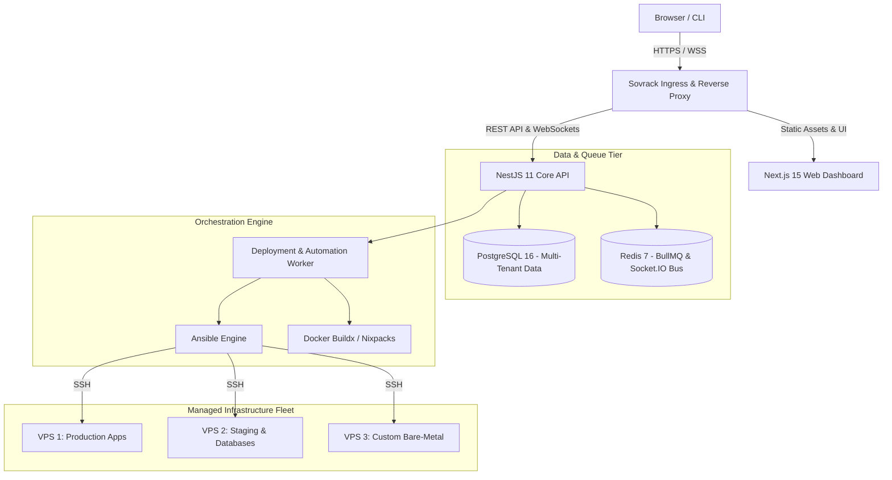

# Sovrack 🛡️

**Sovereign Self-Hosted PaaS & Multi-Server Infrastructure Orchestration Platform**

[](LICENSE)
[](https://nextjs.org/)
[](https://nestjs.com/)
[](https://www.typescriptlang.org/)
[](https://www.docker.com/)
[](https://www.postgresql.org/)
[](https://redis.io/)

[Website](https://sovrack.com) • [Documentation](https://docs.sovrack.com) • [Live App](https://app.sovrack.com) • [Community](https://github.com/sovrack/sovrack/discussions)

---

## 📖 Introduction

**Sovrack** is a modern, enterprise-ready, open-core cloud platform and deployment orchestrator designed to reclaim full sovereignty over your infrastructure. Run applications, databases, and microservices across any fleet of bare-metal servers or cloud VPS (Hetzner, OVH, AWS, DigitalOcean, Scaleway, GCP) with zero vendor lock-in and zero hyperscaler markups.

Whether you need automatic Git builds, Vercel-like single-page application hosting with zero configuration, isolated Staging environments, or full Ansible multi-node provisioning, Sovrack delivers an integrated, intuitive developer experience backed by enterprise security controls.

---

## ✨ Key Capabilities

- 🚀 **Multi-Server Fleet Management**: Connect any Linux VPS via secure SSH keys or automated agent runners. Distribute services across multiple clusters seamlessly.
- ⚡ **Intelligent Multi-Engine Builds**:
  - **Nixpacks Engine**: Zero-configuration auto-detection for Node.js, Python, Go, Rust, Ruby, PHP, and Java.
  - **Docker Engine**: Native Dockerfile builds and multi-stage optimizations.
  - **Static & SPA Engine**: Embedded high-performance Nginx with automated SPA client routing (`try_files $uri /index.html`), gzip compression, and immutable cache headers.
- 🔄 **Trunk-Based Staging & Production Isolation**:
  - Independent staging environments with isolated databases (`sovrack_staging`).
  - 1-click manual promotions to production with identical container image SHAs.
- 📊 **Real-Time Observability**:
  - Live container log streaming powered by WebSocket and Socket.IO.
  - Full in-browser interactive SSH terminal built on `xterm.js`.
  - Prometheus metrics exporter and system health dashboards.
- 🌐 **Automated Ingress & SSL**:
  - Dynamic reverse proxy routing with automatic Let's Encrypt TLS certificates.
  - Custom domain management and zero-downtime rolling deploys.
- 🛡️ **Enterprise Security & Governance**:
  - Multi-tenant workspace isolation with role-based access control (RBAC).
  - Argon2id password hashing and Time-based One-Time Password (TOTP) MFA.
  - Granular staff impersonation with immutable tamper-evident audit logging.
  - Selective Light & Dark theme support designed for 24/7 operations.

---

## 🏛️ System Architecture



---

## ⚖️ Platform Comparison

| Feature | Sovrack | Vercel / Netlify | AWS ECS / GCP | Coolify |
| :--- | :---: | :---: | :---: | :---: |
| **Hosting Model** | **Self-Hosted / Sovereign** | Proprietary Cloud | Proprietary Cloud | Self-Hosted |
| **Server Provisioning** | **Multi-Node Ansible & SSH** | Serverless Only | Complex IAM/VPC | Docker SSH |
| **Pricing** | **Free & Open Source** | Usage-based / High markup | Per-resource / High | Free / Donation |
| **Static & SPA Engine** | **Nginx + Gzip + Cache** | Edge Network | CloudFront + S3 | Basic Nginx |
| **Staging Isolation** | **Dedicated DB + Envs** | Branch Previews | Complex Stacks | Manual Setup |
| **RBAC & Impersonation** | **Enterprise Built-In** | Team Plans ($$$) | IAM Policies | Single/Basic Team |
| **In-Browser Terminal** | **Yes (`xterm.js`)** | No | CloudShell ($) | Basic Shell |

---

## 🚀 Quick Start

### 1-Line VPS Automated Installer (Ubuntu / Debian)

Run the official bootstrap script on a clean Ubuntu 22.04+ or Debian 12 server:

```bash
curl -fsSL https://raw.githubusercontent.com/sovrack/sovrack/main/install.sh | sudo bash
```

The installer automatically prepares Docker, creates isolated networks, provisions production databases, sets secure cryptographic keys, and exposes the dashboard on port `3000`.

---

### Local Development Setup

To run Sovrack locally for development or contribution:

#### Prerequisites
- Node.js `>= 20.0.0`
- Docker & Docker Compose
- Git

#### 1. Clone the repository
```bash
git clone https://github.com/sovrack/sovrack.git
cd sovrack
```

#### 2. Install dependencies
```bash
npm ci
```

#### 3. Start local Postgres and Redis
```bash
docker compose -f infra/docker-compose.dev.yml up -d
```

#### 4. Apply migrations and seed local RBAC data
```bash
cd apps/server
npx prisma migrate status
$env:ALLOW_LOCAL_SEED="true"; node --env-file=.env prisma/seed-local.js
cd ../..
```

#### 5. Launch Development Servers
In two terminal tabs:
```bash
# Terminal 1: NestJS API server (Port 3001)
npm run dev:server

# Terminal 2: Next.js Frontend Dashboard (Port 3000)
npm run dev:web
```

#### Access Points
- **Web Dashboard**: [http://localhost:3000](http://localhost:3000)
- **API Health Check**: [http://localhost:3001/health/ready](http://localhost:3001/health/ready)
- **Interactive Swagger Docs**: [http://localhost:3001/api](http://localhost:3001/api)

#### Local Test Credentials
- **Owner**: `owner@sovrack.test` / `Local-Client-2026!`
- **Admin**: `admin@sovrack.test` / `Local-Client-2026!`

---

## 🔒 Open-Core & Licensing

Sovrack follows an **Open-Core** model:
- **Community Core (`apps/server`, `apps/web`, `infra`)**: Distributed under the permissive **Apache License 2.0**. You are free to use, inspect, host, and modify the code.
- **Enterprise Extensions (`ee/`)**: Advanced commercial add-ons (multi-cluster federation, air-gapped license keys, compliance reporting) distributed under a commercial license.

For license details, refer to the [LICENSE](LICENSE) file.

---

## 🛡️ Security

We take platform security very seriously. If you discover a vulnerability in Sovrack, please review our [Security Policy](SECURITY.md) and report it responsibly rather than opening a public issue.

---

## 🤝 Contributing

Contributions, bug reports, and feedback are welcome! Please consult [CONTRIBUTING.md](CONTRIBUTING.md) and our [Code of Conduct](CODE_OF_CONDUCT.md) before submitting pull requests.

---

<p align="center">
  <sub>Built with pride for sovereign cloud engineering. © 2026 Habib Drira and Contributors.</sub>
</p>
