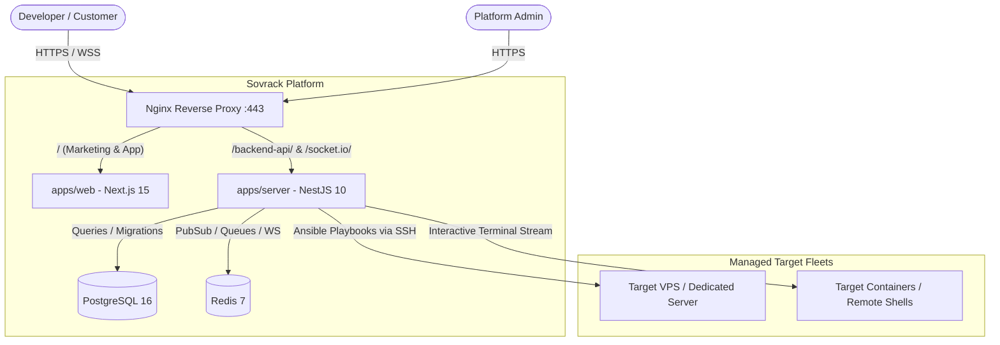

# Sovrack 🚀

[](https://github.com/sovrack/sovrack/actions/workflows/ci.yml)
[](LICENSE.md)
[](https://www.typescriptlang.org/)
[](https://nestjs.com/)
[](https://nextjs.org/)
[](https://www.docker.com/)

**Sovrack** is a modern, enterprise-grade multi-server deployment and infrastructure orchestration platform. It empowers developers and teams to manage servers, execute automated deployments, stream live container logs, and open secure in-browser SSH sessions across their fleet.

---

### ⚡ 1-Click Automated Install (Self-Hosted Linux / VPS)

Install Sovrack Community Edition on your Ubuntu/Debian server in under 2 minutes:

```bash
curl -fsSL https://raw.githubusercontent.com/sovrack/sovrack/main/install.sh | sudo bash
```

*Runs Docker, generates cryptographically secure secrets, configures services, and opens the dashboard on `http://<SERVER_IP>:3000`.*

---

## 🏛️ Architecture Overview

Sovrack is architected as an audited, high-assurance monorepo structured into decoupled applications and production infrastructure:

```text
sovrack/
├── apps/
│   ├── server/       # Core Orchestrator (NestJS, Prisma, Ansible, SSH WebSockets, Swagger)
│   └── web/          # Unified Web Portal (Next.js multi-zone: Marketing, App & Staff)
├── infra/            # Production & Dev Infrastructure (Docker Compose, Nginx, Certbot)
├── .github/          # CI/CD Automation Workflows
├── LICENSE.md        # Business Source License 1.1
└── package.json      # Unified Monorepo Workspaces
```



---

## ✨ Key Features

- **Multi-Host Orchestration:** Automated target server provisioning, Docker engine installation, and hardening using embedded Ansible playbooks.
- **In-Browser Terminal:** Low-latency, secure interactive SSH shells powered by Xterm.js and WebSockets directly in your dashboard.
- **Real-Time Deployment Streams:** Real-time log streaming for builds, migrations, and deployments backed by Redis pub/sub.
- **Multi-Tenant Workspace & Staff Governance:** Granular Role-Based Access Control (RBAC), multi-organization switching, audit trails, and dedicated back-office staff portals.
- **Production-Hardened Security:** Automated Let's Encrypt TLS renewal, Nginx request isolation, CSP protection, and rate-limiting.

---

## 🚀 Quickstart (Local Development)

### Prerequisites

- **Node.js** >= 20.0.0
- **npm** >= 10.0.0
- **Docker** and **Docker Compose**

### 1. Clone the repository

```bash
git clone git@github.com:sovrack/sovrack.git
cd sovrack
```

### 2. Install dependencies

```bash
# Install dependencies across all workspaces
npm --workspace=@sovrack/server install
npm --workspace=@sovrack/web install
```

### 3. Start local development environment

You can run the full local stack (PostgreSQL, Redis, Mailpit, Server, and Web) using Docker Compose:

```bash
cd infra
make local-up
```

- **Customer App:** [http://app.sovrack.localhost:13080](http://app.sovrack.localhost:13080)
- **Public Site & Docs:** [http://sovrack.localhost:13080](http://sovrack.localhost:13080)
- **Staff Back-Office:** [http://staff.sovrack.localhost:13080](http://staff.sovrack.localhost:13080)
- **API Swagger Documentation:** [http://localhost:13013/api/docs](http://localhost:13013/api/docs)
- **Mailpit (Local Emails):** [http://localhost:18025](http://localhost:18025)

---

## 📦 Commercial & Deployment Offerings

1. **Sovrack Cloud (Managed SaaS):** Managed, zero-maintenance platform hosted on [sovrack.tech](https://sovrack.tech).
2. **Sovrack Enterprise (On-Premise):** Self-hosted inside your own private datacenter or VPC for strict regulatory compliance, dedicated support, and sovereign data residency.

---

## 📄 License & Community Model

Sovrack is licensed under the **Business Source License 1.1 (BSL 1.1)**.

- **Free for Non-Commercial & Evaluation:** You are free to inspect, audit, test, and use the software for personal, educational, and evaluation purposes.
- **Commercial Use:** Any production commercial use by businesses or use of the code to offer a competing deployment service requires a commercial license from the Licensor.
- **Change Date:** 4 years after each release, the license automatically converts to the **Apache License, Version 2.0**.

For commercial licensing, enterprise inquiries, or partnership opportunities, contact: **contact@sovrack.tech**.

---

© 2026 **Sovrack** — Created by [Habib Drira](https://github.com/habibdrira). All rights reserved.
