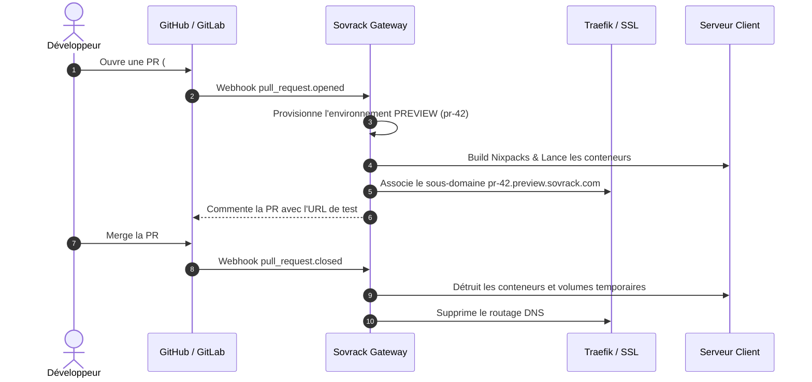

# Environnements Éphémères (« Preview Environments »)

Les **Environnements Éphémères** permettent de déployer automatiquement une copie isolée de votre application dès qu'une Pull Request (GitHub) ou une Merge Request (GitLab) est ouverte, et de la détruire automatiquement dès que la PR est mergée ou fermée.

---

## 🌟 Bénéfices

- **Validation produit instantanée** : Partagez une URL live (`https://pr-42.monsite.preview.sovrack.com`) avec vos testeurs, designers ou clients avant le merge.
- **Tests End-to-End isolés** : Chaque PR dispose de sa propre base de données ou utilise des mocks sans impacter l'environnement de staging ou de production.
- **Zéro gaspillage de ressources** : Destruction automatique dès fermeture de la PR pour libérer la RAM et le CPU de votre infrastructure.

---

## 🔄 Cycle de Vie d'une Preview

---

## 🛠️ Configuration du Webhook

1. Rendez-vous dans **Projets** › Sélectionnez votre projet › **Réglages**.
2. Dans la section **Webhooks Git**, copiez l'URL de notification générée :
   `https://app.sovrack.com/api/v1/webhooks/github` (ou `/gitlab`).
3. Dans les paramètres de votre dépôt GitHub (`Settings > Webhooks`) :
   - **Payload URL** : L'URL copiée ci-dessus.
   - **Content type** : `application/json`.
   - **Secret** : Le secret webhook de votre projet.
   - **Events** : Cochez *Pushes* et *Pull requests*.

---

## 🏷️ Routage & Nommage Dynamique

Chaque environnement éphémère hérite du format standard :
- **Sous-domaine** : `pr-<IID>.<project-slug>.preview.<votre-domaine.com>`
- **Exemple** : `https://pr-14.dashboard.preview.sovrack.com`

---

## 🧹 Rétention & Nettoyage Automatique

Pour éviter toute surcharge de disque ou de mémoire sur vos serveurs, Sovrack applique des règles d'assainissement strictes :
- **Sur événement `closed` ou `merged`** : Arrêt immédiat des conteneurs, suppression des volumes éphémères et suppression des certificats associés.
- **Nettoyage automatique TTL (Time-To-Live)** : Tout environnement preview sans activité depuis plus de 7 jours est automatiquement archivé.
